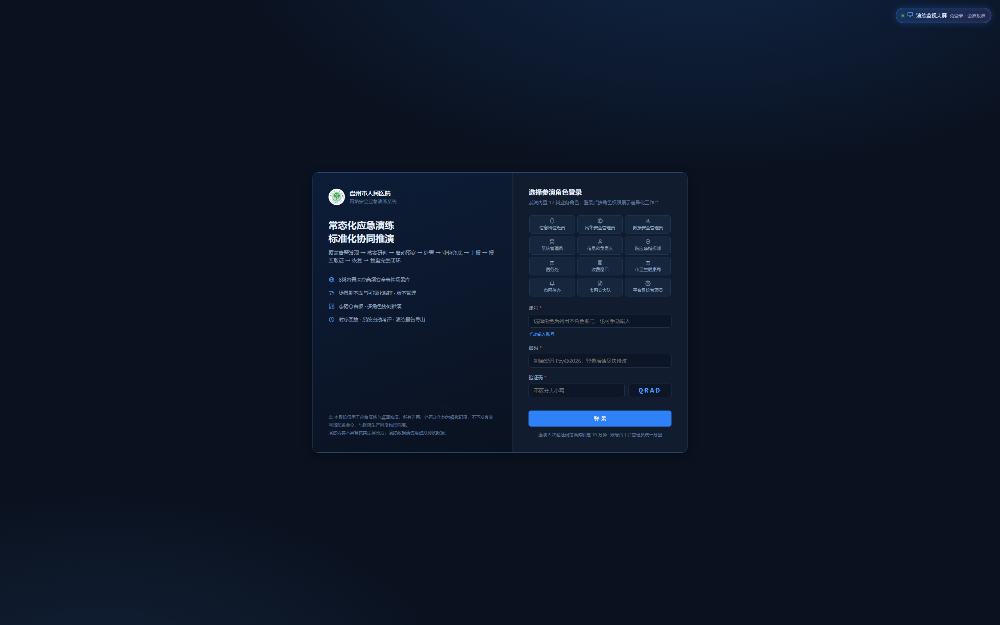
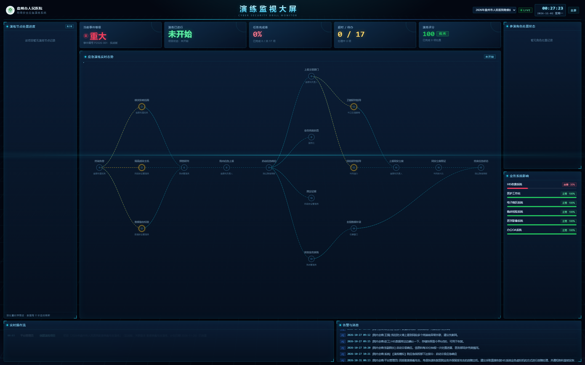

# 盘州市人民医院网络安全应急演练系统

> 局域网部署版 · 常态化应急演练 · 标准化协同推演



## 功能概览

本系统面向医疗机构网络安全场景，提供从剧本编辑、角色协同、任务下发到监视大屏、评分复盘的全流程演练能力：

- **两种模式**：基础版（教学/单人演练）、实战版（多角色协同 + 外部联动）
- **8 套预置剧本**：勒索病毒、钓鱼攻击、数据泄露、系统入侵等常见场景
- **12 类角色**：信息科值班员、网络安全管理员、系统管理员、信息科负责人、院应急指挥部、医务处、收费窗口、市卫生健康局、市网信办、市网安大队等
- **剧本可视化编辑器**：拖拽式节点编排，支持主线 + 混淆干扰节点
- **演练监视大屏**：实时节点链路、任务进度、业务系统影响、告警消息滚动
- **评分与复盘**：按节点完成度、时效、质量自动评分，生成扣分原因



## 运行要求

| 项目 | 要求 |
|------|------|
| Node.js | >= 22.5.0 |
| 操作系统 | Windows 10/11 或 Windows Server（局域网部署） |
| 数据库 | SQLite（自动内嵌，无需额外安装） |
| 浏览器 | Chrome / Edge（推荐最新版） |

## 安装与启动

```bash
# 1. 克隆仓库
git clone <repository-url>
cd cyber-drill-system

# 2. 安装依赖
npm install

# 3. 启动服务
npm start
```

服务默认运行在 **http://127.0.0.1:8080**。

首次启动时系统会自动创建 SQLite 数据库（`data/drill.db`）并导入全部预置剧本、角色、项目模板数据。

## 目录结构

```
cyber-drill-system/
├── server.js                    # Express 入口
├── package.json                 # 依赖与脚本
├── src/
│   ├── db.js                    # SQLite 连接与迁移
│   ├── scenario_baseline.js     # 预置剧本基线数据（8 场景 S01-S08）
│   ├── seed.js                  # 数据初始化脚本
│   └── routes/                  # API 路由
│       ├── auth.js              # 角色认证
│       ├── content.js           # 项目/剧本/节点/监视大屏
│       └── tasks.js             # 任务下发与状态变更
├── public/                      # 前端静态页
│   ├── index.html               # 首页 / 登录
│   ├── workbench.html           # 角色工作台
│   ├── screen.html              # 演练监视大屏
│   ├── scenarios.html           # 剧本编辑器
│   └── assets/                  # JS/CSS 资源
├── data/
│   └── drill.db                 # SQLite 数据库（运行时生成）
├── uploads/                     # 用户上传附件（自动创建）
└── docs/
    └── screenshots/             # README 截图
```

## 快速上手

1. 浏览器打开 `http://127.0.0.1:8080`
2. 在登录页选择一个角色（如"平台管理员"），输入验证码进入
3. 平台管理员可创建演练项目、选择剧本、启动演练
4. 各角色登录各自工作台，按剧本链路完成任务
5. 指挥中心打开 `http://127.0.0.1:8080/screen.html` 查看监视大屏

## 版本历史

- **v0.2.3** — impact 表按项目隔离、S01 剧本重写（52 节点）、baseline apply 改 DB 优先合并模式、节点简称与 anchor 混淆机制
- **v0.2.0** — 8 套预置剧本、12 角色协同、剧本可视化编辑器、监视大屏、自动评分
