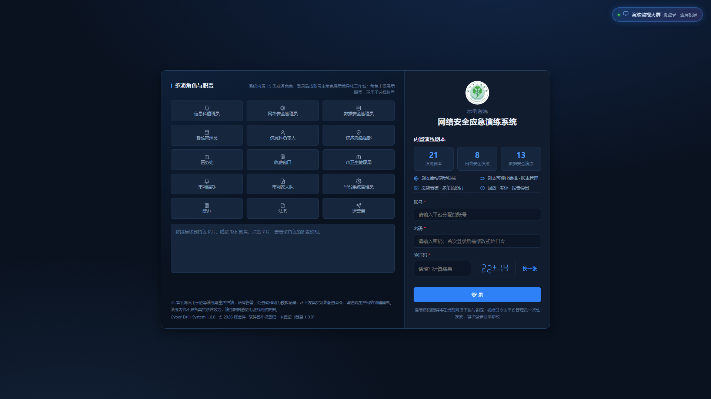
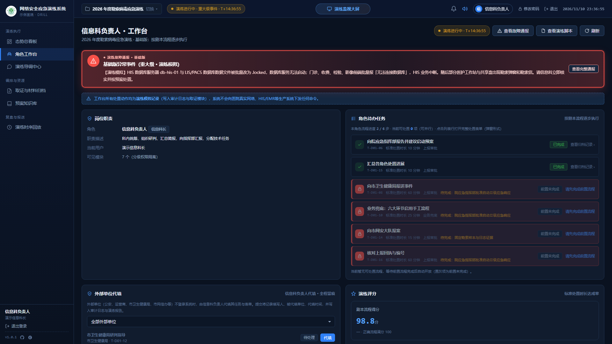
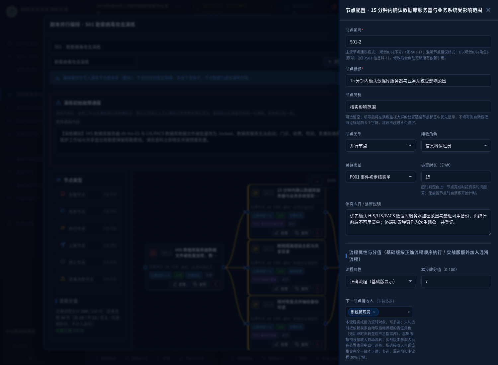
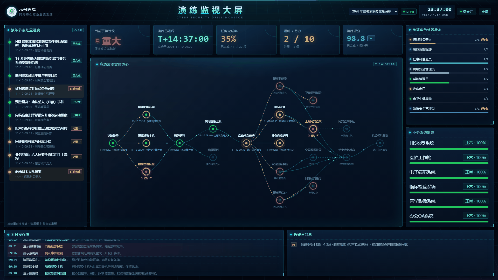
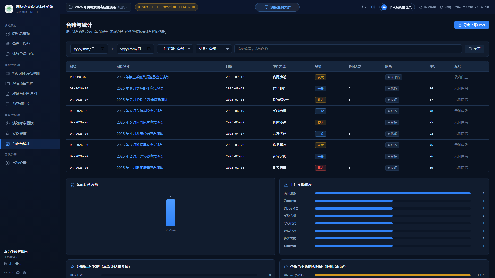
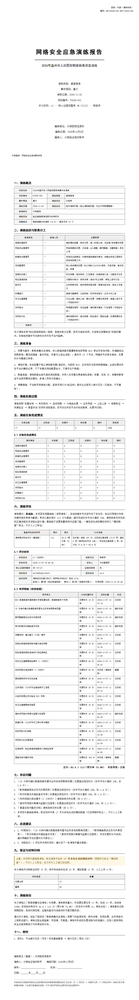

# 应急演练指挥系统（Cyber-Drill-System）

> **使用中遇到问题，请优先查阅 Wiki：**
> GitHub <https://github.com/chenjinxiang1980/cyber-drill/wiki> ｜ Gitee <https://gitee.com/habeas/cyber-drill/wiki>
> 安装、升级、配置、常见问题、评分口径、备份恢复都在 Wiki 里持续维护。

面向医院、政府与企事业单位**内网**的桌面推演 + 实战演练指挥调度平台：内置勒索病毒、横向渗透、DDoS、钓鱼邮件、存储故障等高频安全事件剧本，覆盖演练编排、多角色协同、时序控制、处置记录、监视大屏、自动考评与复盘报告全流程。

> 当前版本：**1.0.1** · 许可证：MIT © 2026 陈金祥 · 软件著作权登记：**未登记**（截至 1.0.0）

---

## 界面预览

截图使用内置演示数据渲染，不含真实账号与内网地址。

| 登录页 | 角色工作台 |
|---|---|
|  |  |

| 剧本编辑（可视化流程） | 演练监视大屏 |
|---|---|
|  |  |

| 台账与统计 | 复盘报告导出 |
|---|---|
|  |  |

---

## 功能概览

- **演练监视大屏**：1920×1080 大屏，实时操作流、角色处置状态、告警与消息三栏滚动。
- **角色工作台**：值班员 / 指挥员 / 管理员等角色工作台，处置弹窗、任务清单、业务系统影响态势。
- **剧本编排**：节点化可视化编辑、`before` / `after` 混淆门控、剧本版本历史与大/小版本策略。
- **演练项目管理**：项目状态机、基础版 / 实战版、参演单位与观察员、演练计时基准。
- **复盘与考评**：按节点时序自动评分、扣分项说明、演练报告导出（Word / TXT / HTML）、时序回放。
- **取证与台账**：证据归档与哈希保管链、操作台账、知识库与字典。
- **站内消息与会商**：按项目隔离的消息、未读计数、可选语音播报；演练期间多角色会商留痕。
- **安全加固**：JWT + Session + RBAC、登录失败锁定、算术验证码、TLS、审计日志、加密备份。
- **交付形态**：Go 单体二进制 + MySQL 8.0；前端为静态资源，由服务端直接托管，无前端构建链。

---

## 一键安装（唯一入口）

**Linux + Docker 的唯一一键安装脚本是 [`deploy/install/install.sh`](deploy/install/install.sh)。**
仓库中不存在其他一键安装入口；`deploy/linux/` 下的 systemd / compose 文件仅作为物理机手工部署参考。

前置条件：Linux x86_64、root 权限、可访问 Docker 镜像仓库（或准备离线包）、≥ 3GB 磁盘。
运行环境**优先 openEuler 24.03 LTS-SP1**（已在实机验证）；**统信 UOS Server 20** 为兼容可选项——两者同为 dnf 系，
但安装器在线安装的 Docker 引擎（`moby-engine` + `container-selinux`）取自 openEuler 源，UOS 上需按现场仓库或离线 RPM 提供。

```bash
git clone https://github.com/chenjinxiang1980/cyber-drill.git
cd cyber-drill
sudo bash deploy/install/install.sh
```

安装器会自动完成：安装/检查 Docker 与 Compose → 选择镜像源并拉取镜像 → 生成随机强口令 `.env`（权限 600）→ 启动 MySQL → 恢复 1.0.1 基线快照 → 启动应用 → 健康检查 → **在终端打印 `admin` 与 `platformadmin` 初始口令**。

### 镜像源选择

安装器会探测 GHCR 与华为云 SWR 的连通性并给出建议，也可以显式指定：

| 参数 | 行为 |
|---|---|
| `--image-source auto` | 默认。自动探测；两者均可达时交互选择，非交互环境按本地时区选择 |
| `--image-source ghcr` | 使用 `ghcr.io/chenjinxiang1980/cyber-drill:<版本>`（国外网络） |
| `--image-source swr` | 使用 `swr.cn-east-3.myhuaweicloud.com/chenjinxiang/cyber-drill:<版本>`（国内推荐） |

镜像 tag 始终取仓库根目录 `VERSION` 文件（可用 `--version` 覆盖），不再写死任何历史版本号。

### 初始口令

- 安装结束时会明确打印 **`admin`** 与 **`platformadmin`** 的初始口令，并标注“仅显示一次”。
- 口令同时落盘在安装目录的 `.env`（权限 600），输出中会给出完整路径。
- **首次登录必须立即修改初始口令**；修改后 `.env` 中的初始口令即失效。

### 已安装过怎么办

安装器检测到安装目录（默认 `/opt/cyber-drill`）已存在且非空时会**直接停止**，不会覆盖旧数据，并给出两条路径：

```bash
# A. 删除原目录、容器与数据卷后重新安装（交互输入 DELETE 确认，不能回车即删）
sudo bash deploy/install/install.sh --reinstall

# B. 保留数据，改用升级脚本
sudo bash deploy/upgrade/upgrade.sh --to 1.0.1
```

非交互环境执行 A 分支时必须显式提供确认词：

```bash
sudo bash deploy/install/install.sh --reinstall --confirm DELETE
```

### 常用参数

| 参数 | 说明 |
|---|---|
| `--install-dir <目录>` | 安装目录，默认 `/opt/cyber-drill` |
| `--port <端口>` | 应用对外端口，默认 `8090` |
| `--mysql-port <端口>` | MySQL 宿主机回环端口，默认 `3306` |
| `--offline-dir <目录>` | 离线资源目录（`rpms/`、`images/`、`baseline/`、`bin/docker-compose`） |
| `--snapshot <文件>` | 指定基线快照 `.sql.gz` |
| `--tls-cert/--tls-key` | 启用应用内 HTTPS（对外交付必须上 TLS） |
| `--show-secrets` | 再次打印初始口令（默认仅首次安装打印一次） |
| `--skip-firewall` | 不修改 firewalld |
| `--help` | 查看完整参数与退出码 |

### Windows

Windows 不提供原生一键安装脚本。推荐使用 **Docker Desktop + WSL2**，参考 [`deploy/docker-desktop/README.md`](deploy/docker-desktop/README.md)。不建议在 Windows 本机直接运行编译产物（终端安全软件可能误报拦截）。

---

## 升级

容器部署使用升级脚本，自动完成备份 → 数据库迁移 → 拉取镜像 → 重建应用 → 健康校验，失败自动回滚：

```bash
sudo bash deploy/upgrade/upgrade.sh --status
sudo bash deploy/upgrade/upgrade.sh --to 1.0.1 --dry-run
sudo bash deploy/upgrade/upgrade.sh --to 1.0.1
```

版本链与升级矩阵见 [`docs/upgrade.md`](docs/upgrade.md) 与 [`deploy/upgrade/manifest.json`](deploy/upgrade/manifest.json)。

---

## 从源码编译

要求 Go 1.27+、`CGO_ENABLED=0`，目标平台 `linux/amd64`：

```bash
cd server
export GOOS=linux GOARCH=amd64 CGO_ENABLED=0
VERSION=$(cat ../VERSION)
go build -trimpath -ldflags "-s -w -X drill-system/internal/version.Version=${VERSION}" -o ../dist/drill-server .
go build -trimpath -ldflags "-s -w -X drill-system/internal/version.Version=${VERSION}" -o ../dist/drill-migrate ./cmd/migrate
go build -trimpath -ldflags "-s -w -X drill-system/internal/version.Version=${VERSION}" -o ../dist/drill-seed ./cmd/seed
```

完整说明（版本注入、交叉编译、只升级数据库）见 [`docs/build-from-source.md`](docs/build-from-source.md)。

---

## 目录结构

```text
Emergency/
├── server/                  # Go 后端（Gin + MySQL）
├── public/                  # 前端静态页面（无构建步骤，由服务端托管）
├── migrations/              # 0000_bootstrap … 0123_brand_version_100（1.0.1 共 76 条）
├── deploy/
│   ├── install/             # ★ 唯一一键安装入口（install.sh + 基线快照）
│   ├── upgrade/             # 升级脚本与版本清单
│   ├── docker-dist/         # 多阶段镜像构建
│   ├── docker-desktop/      # 跨平台 / 本机开发 compose
│   └── linux/               # 物理机 systemd / nginx / caddy 参考
├── docs/                    # 部署、安全、合规、发版文档与截图
├── scripts/                 # 构建辅助脚本
├── VERSION                  # 版本号单一来源
├── THIRD-PARTY-NOTICES.md   # 第三方组件与许可证
└── LICENSE                  # MIT
```

---

## 文档与常见问题

| 主题 | 入口 |
|---|---|
| 安装（openEuler / Docker） | [docs/install-docker-openeuler.md](docs/install-docker-openeuler.md) |
| 升级与回滚 | [docs/upgrade.md](docs/upgrade.md) |
| 源码编译 | [docs/build-from-source.md](docs/build-from-source.md) |
| Linux / systemd / 反向代理 | [docs/linux-deployment.md](docs/linux-deployment.md) |
| 安全加固与登录策略 | [docs/security-guide.md](docs/security-guide.md) |
| 个人信息处理说明（医院/政府交付） | [docs/privacy-data-processing.md](docs/privacy-data-processing.md) |
| 1.0.0 发版说明与已知限制 | [docs/release-1.0.0.md](docs/release-1.0.0.md) |
| 第三方组件与许可证 | [THIRD-PARTY-NOTICES.md](THIRD-PARTY-NOTICES.md) |
| 常见问题、评分与剧本口径、备份恢复 | **Wiki**（见页首链接） |

Wiki 主要页面：安装、升级、配置项、常见问题、评分与剧本口径、备份与恢复。

---

## 许可证

MIT License，版权人：陈金祥（© 2026）。第三方组件许可见 [THIRD-PARTY-NOTICES.md](THIRD-PARTY-NOTICES.md)。
