# 盘州市人民医院网络安全应急演练系统

> 版本：0.1.0　适用：Windows 10/11、Windows Server 2016 及以上（局域网部署）
> 架构：Node.js + Express + SQLite 单文件数据库，前端为本机静态页面，无外部 CDN、无外网依赖。

**本系统为纯演练推演平台**：所有告警、接单、处置、上报、报案动作均为模拟记录，仅写入演练台账、取证模块与审计日志，**不会下发任何真实网络配置命令**，不操作医院生产网络、服务器与数据库。

---

## 一、系统概述

系统面向医院网络安全应急演练与桌面推演，覆盖「告警发现 → 核实研判 → 启动预案 → 分角色处置 → 业务兜底 → 上级上报 → 报案取证 → 恢复验证 → 复盘评估」全流程，内置：

- **11 类参演角色**：院应急指挥部、信息科负责人/值班员、网络安全管理员、系统管理员、医务部/门诊部负责人、临床科室/收费窗口、市卫生健康局、市网信办、市网安大队、平台系统管理员；
- **8 类医疗高频安全事件场景**：勒索病毒、内网渗透、DDoS、钓鱼邮件、系统宕机、数据泄露等，每类场景内置标准处置基线（8 个节点，其中 6 个必经步骤）；
- **两种演练模式**：
  | 演练模式 | 考评方式 | 计分规则 |
  | --- | --- | --- |
  | 基础版（诱导演练） | 系统按剧本节点逐节点下发任务并给出处置引导提示 | **仅对操作时限打分**：按时完成节点数 ÷ 应完成节点总数 × 100 |
  | 实战版（自主处置） | 参演人员自行录入处置步骤（动作类型 + 标题 + 实际时刻） | **步骤遗漏 70% + 时限 30%**：按基线必经步骤判定遗漏，按基线时限判定达成 |
- **14 个功能页面**：态势总看板、演练监视大屏、任务协同中心、角色工作台、协同会商中心、场景剧本库、剧本可视化编排、演练项目管理、取证与材料归档、预案知识库、公告与舆情模拟、演练时序回放、复盘评估、演练报告导出、台账与统计、系统基础管理；
- **分级权限与数据隔离**：除院应急指挥部外，各角色仅可见/可处置本角色任务；外部单位（市卫健局、市网信办、市网安大队）仅能查看医院主动上报的表单文书、上报材料、报案材料，不可见内网原始技术日志与取证明细；
- **审计留痕**：登录、接单、提交、完成、上传、备份等操作均记录账号、角色、动作、IP、时间，审计日志仅追加、不可删除。

## 二、目录结构

```
cyber-drill-system\
├─ server.js              服务端入口
├─ package.json
├─ public\                 前端页面（14 个功能页 + 登录页）
├─ src\                    服务端源码（路由、数据库、鉴权、初始化数据）
│  ├─ routes\              业务路由（auth/bootstrap/tasks/evidence/content/admin/drill）
│  ├─ db.js                SQLite 连接与表结构迁移
│  ├─ seed.js              初始数据导入（角色、账号、场景、剧本、任务等）
│  └─ schema.sql           数据库表结构
├─ data\                   SQLite 数据库与备份（首次启动自动生成 drill.db）
├─ uploads\                证据附件与自动取证截图（按年月分目录）
└─ docs\                   安装说明、使用说明与页面截图
```

## 三、快速开始

### 1. 环境要求

- **Node.js ≥ 22.5.0**（系统使用 Node 内置 `node:sqlite` 模块，无需安装数据库、无需编译原生模块）；
- 端口默认 **8080**，浏览器推荐 Chrome 100+（屏幕截图取证依赖 `getDisplayMedia`）；
- 建议部署在独立演练服务器/虚拟机，与 HIS、业务网、互联网物理隔离。

### 2. 安装与启动

```powershell
cd D:\cyber-drill-system
npm install        # 依赖仅 express、multer 两个
npm start
```

首次启动自动完成：创建数据库 `data\drill.db` → 导入 11 类角色、11 个账号、8 类场景、剧本节点、任务、时序、评分项等初始数据 → 监听端口并打印访问地址。

**修改端口 / 监听地址**（可选）：

```powershell
$env:DRILL_PORT="8080"        # 端口
$env:DRILL_HOST="0.0.0.0"     # 0.0.0.0 允许局域网访问；127.0.0.1 仅本机
npm start
```

**局域网访问**需以管理员身份放行防火墙端口：

```powershell
netsh advfirewall firewall add rule name="网络安全应急演练系统" dir=in action=allow protocol=TCP localport=8080
```

### 3. 初始账号

| 角色 | 账号 | 初始密码 |
| --- | --- | --- |
| 平台系统管理员 | `admin` | `Pzy@2026` |
| 院应急指挥部 | `yuanzhang` | `Pzy@2026` |
| 信息科负责人 | `chendongzhu` | `Pzy@2026` |
| 信息科值班员 | `liming` | `Pzy@2026` |
| 网络安全管理员 | `wangqiang` | `Pzy@2026` |
| 系统管理员 | `zhaogong` | `Pzy@2026` |
| 医务部/门诊部负责人 | `liuzhuren` | `Pzy@2026` |
| 临床科室/收费窗口 | `sunhushizhang` | `Pzy@2026` |
| 市卫生健康局 | `zhoukeyuan` | `Pzy@2026` |
| 市网信办 | `wuchuzhang` | `Pzy@2026` |
| 市网安大队 | `zhengjingguan` | `Pzy@2026` |

> **首次部署后请立即修改初始密码**（顶栏「修改密码」，新密码至少 8 位且同时包含字母与数字）。忘记密码可由平台管理员在「系统基础管理 → 用户账号」重置为初始密码。

### 4. 常用命令

| 命令 | 说明 |
| --- | --- |
| `npm start` | 启动服务（前台运行，`Ctrl + C` 停止） |
| `npm run seed` | 导入初始数据（全新安装） |
| `npm run reset` | **清空并重建数据库**，重新导入初始数据（会清空现有演练数据，慎用） |
| `http://127.0.0.1:8080/api/health` | 健康检查，返回 `{"ok":true,...}` 即正常 |

> 详细部署、开机自启、备份恢复、升级与故障排查见 [docs/安装说明.md](docs/安装说明.md)；各页面操作细节见 [docs/使用说明.md](docs/使用说明.md)。

## 四、页面功能与截图

### 4.1 登录

左侧角色网格点选参演角色（自动填入账号），输入密码与 4 位验证码登录；连续 5 次验证码错误锁定 10 分钟。

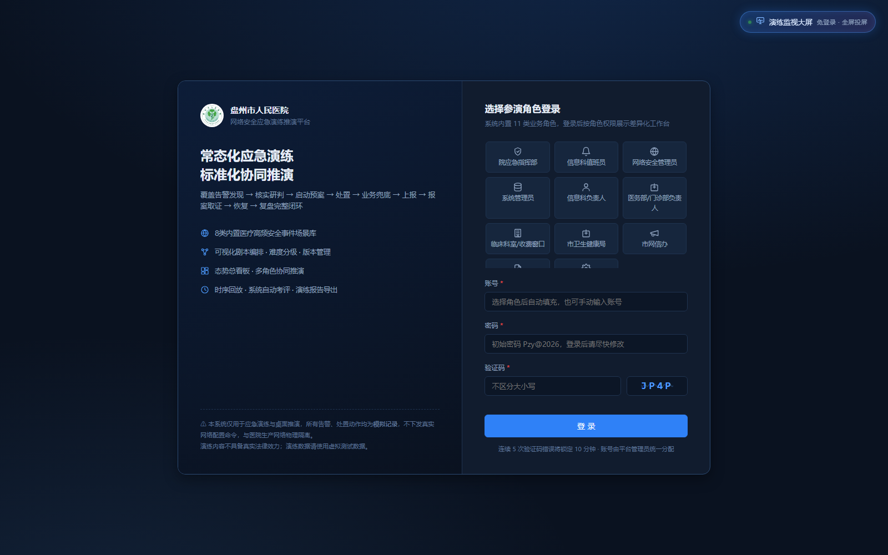

### 4.2 态势总看板

顶部展示当前演练项目、进行状态与演练计时；卡片展示任务总数/待处理/处理中/已完成/超时、告警等级分布、角色处置进度；业务影响面板显示各系统状态（正常/受影响/中断）；下方时间线可跳转时序回放。

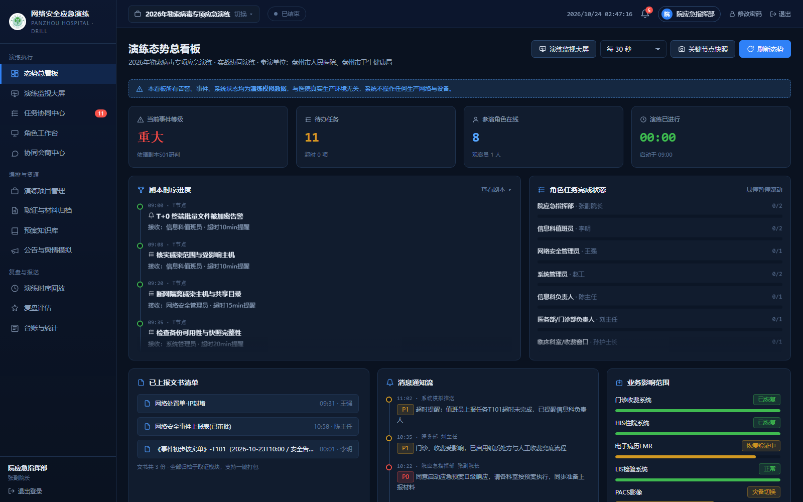

### 4.3 演练监视大屏

面向指挥大厅的全局监视视图，集中展示演练态势、任务进度与关键事件。

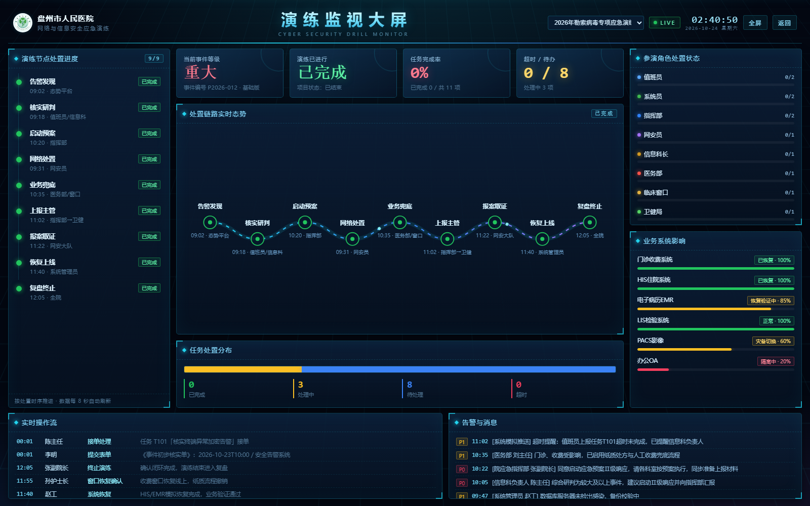

### 4.4 任务协同中心（核心）

按状态与接收角色筛选任务，超时任务高亮警示；任务详情含任务信息、需提交表单（字段已按当前场景自动填充模拟数据）、附件清单（上传证据附件、屏幕截图自动取证）与流转操作（接单 → 提交处置 → 完成）；「删除」仅院应急指挥部、信息科负责人可见。

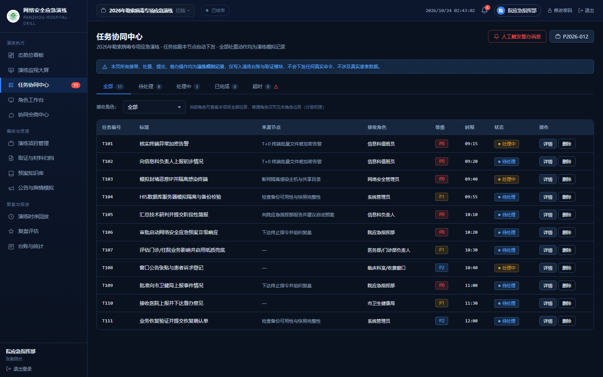

### 4.5 角色工作台

按当前角色展示我的待办任务、我提交的表单、相关告警与通知、快捷入口；当前项目为实战版时，工作台显示「实战版处置步骤录入」卡片，支持按动作类型 + 标题 + 实际时刻录入自主处置步骤。

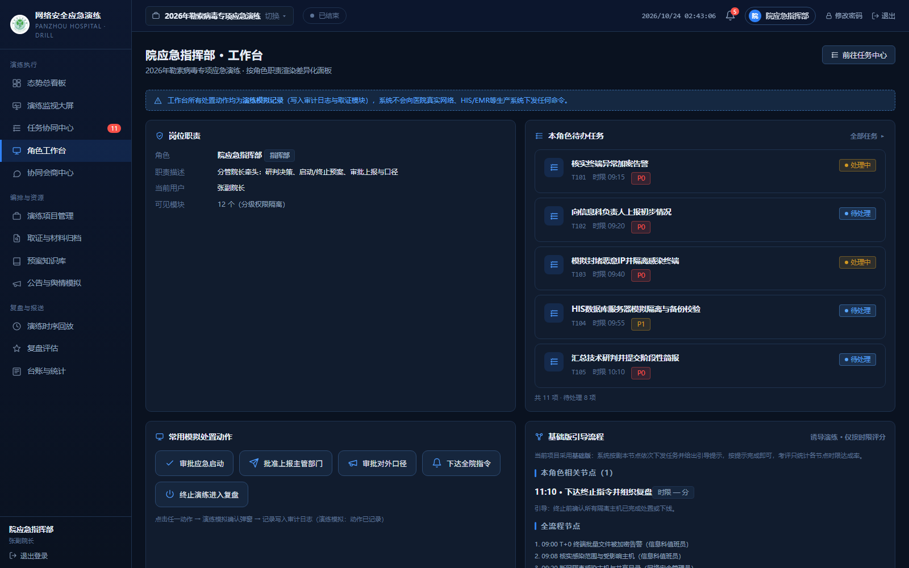

### 4.6 场景剧本库

内置 8 类医疗高频安全事件场景，含等级、难度、版本、节点数与状态，并内置标准处置基线（基础版下发引导流程、实战版判定步骤遗漏）；支持新建场景、编辑描述、复制与版本管理。

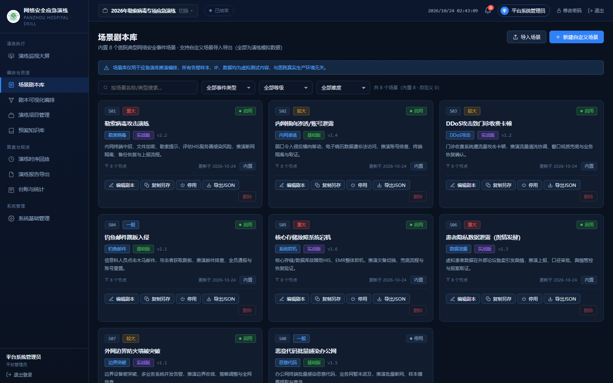

### 4.7 剧本可视化编排

左侧节点库、中间画布、右侧属性面板；节点含来源/目标角色、动作、时限、关联表单、附件要求、等级，以及引导提示（基础版下发）、判定关键词与是否必经步骤（实战版遗漏判定依据）；支持拖拽排序、连线生成处置时序、保存为新版本。

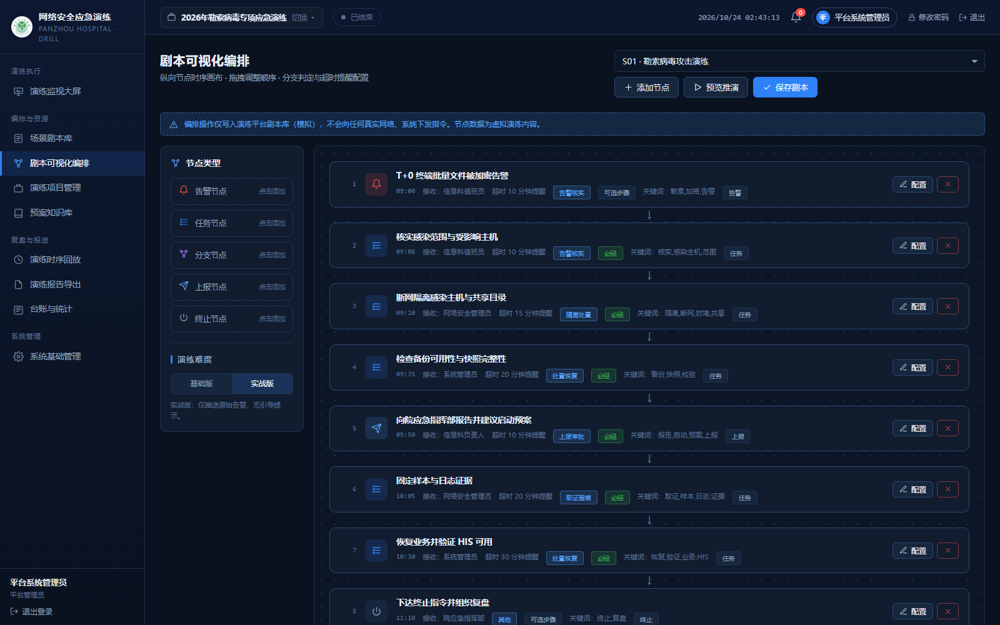

### 4.8 演练项目管理

项目列表含编号、名称、场景、参演单位、起止时间、演练模式（基础版/实战版）与状态；支持新建演练项目（自动生成递增项目编号）、切换当前项目、更新项目状态、启停演练计时。

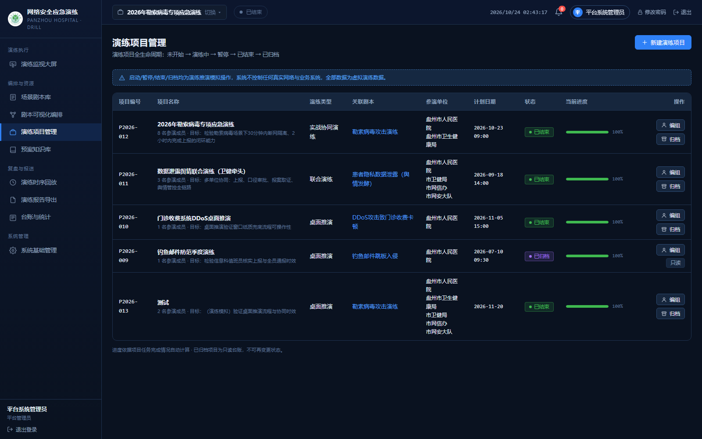

### 4.9 预案知识库

分类浏览应急预案、处置手册、法律法规、案例库，支持关键词搜索与详情查看；平台管理员/院应急指挥部/信息科负责人可上传文档（单文件 ≤ 20 MB）与删除文档，操作写入审计日志。

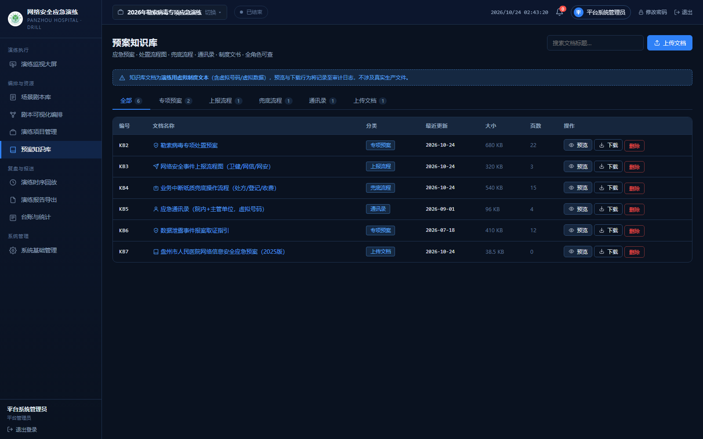

### 4.10 演练时序回放

时间轴按分钟回放告警、接单、处置、上报、恢复等关键动作，可切换演练项目复盘任意一次演练；支持播放/暂停/拖动进度、按事件类型过滤，右侧处置时序图随回放自动点亮节点，可导出处置时序图。

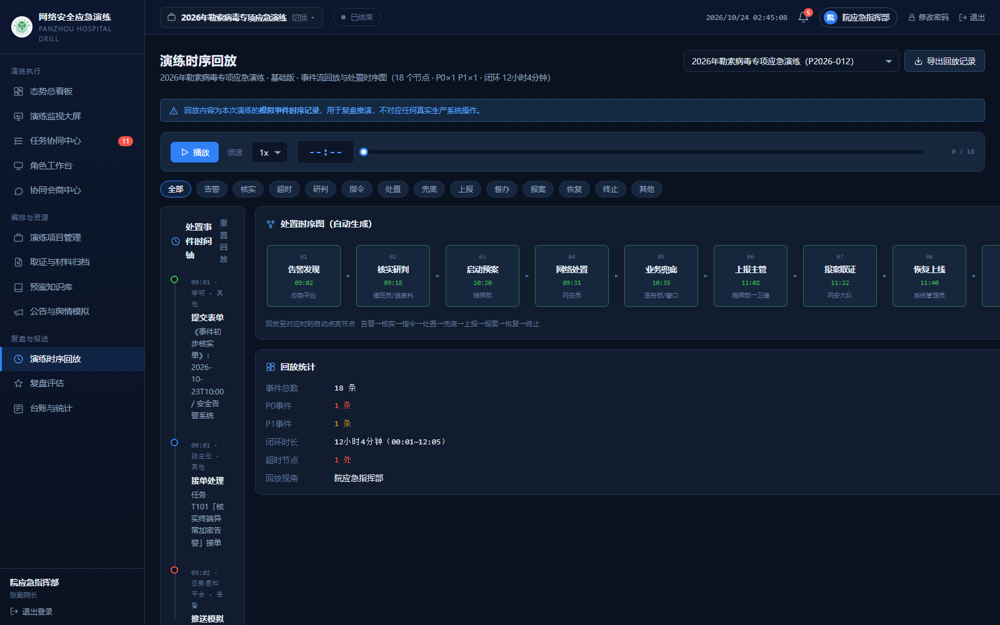

### 4.11 复盘评估

按项目演练模式自动考评：基础版仅对操作时限打分；实战版按「步骤遗漏 70% + 时限 30%」计分，系统按「动作类型 + 关键词 + 责任角色」自动匹配基线节点，未匹配步骤标记为「额外处置」；展示逐节点考评明细、总分、等级、计分公式与自动生成的改进建议，「重新自动考评」结果写入评分记录并留痕。

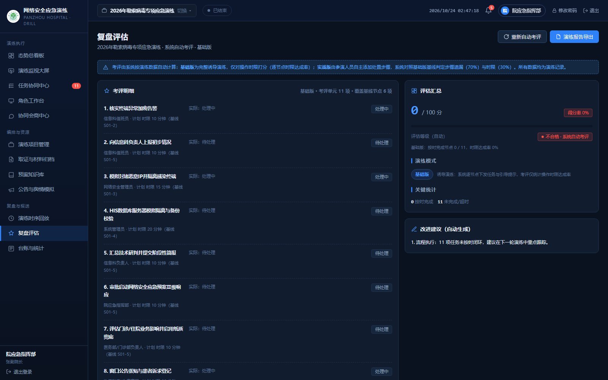

### 4.12 演练报告导出（仅平台系统管理员）

按演练项目生成标准《网络安全应急演练报告》，共十一章（演练概况、组织与职责分工、演练准备、实施过程、任务完成情况、演练评估、存在问题、改进建议、取证与材料归档、演练结论、附件），含封面与编制/审核/批准落款；支持预览、导出 Word、导出 HTML、打印/另存 PDF，导出动作写入审计日志。

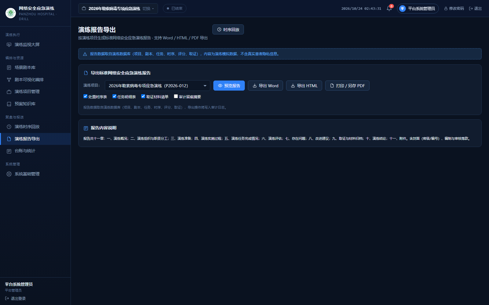

### 4.13 系统基础管理（仅平台系统管理员）

分页签操作：用户与角色管理（新建账号、启用/停用、重置密码）、表单模板管理、审计日志（仅追加不可删除，可导出 CSV）、通知与备份（「立即备份」将数据库复制到 `data\backups`）。

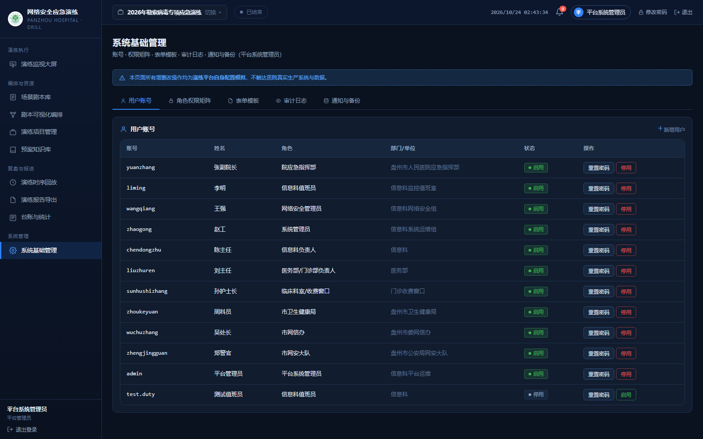

## 五、角色与权限

| 角色 | 账号 | 可见菜单 | 任务范围 |
| --- | --- | --- | --- |
| 院应急指挥部 | `yuanzhang` | 全部业务菜单 | 本项目全部任务，可人工督办 |
| 信息科负责人 | `chendongzhu` | 看板/任务/工作台/会商/取证/回放/知识库 | 本科室条线：信息科负责人、值班员、网络安全管理员、系统管理员任务 |
| 信息科值班员 | `liming` | 任务/工作台/会商/知识库 | 仅本角色任务 |
| 网络安全管理员 | `wangqiang` | 任务/工作台/会商/取证/知识库 | 仅本角色任务 |
| 系统管理员 | `zhaogong` | 任务/工作台/会商/取证/知识库 | 仅本角色任务 |
| 医务部/门诊部负责人 | `liuzhuren` | 任务/工作台/会商/知识库 | 仅本角色任务 |
| 临床科室/收费窗口 | `sunhushizhang` | 任务/工作台/会商/知识库 | 仅本角色任务 |
| 市卫生健康局 | `zhoukeyuan` | 任务/工作台/会商/知识库 | 仅上级报送类任务，取证仅见上报材料 |
| 市网信办 | `wuchuzhang` | 任务/工作台/会商/公告舆情/知识库 | 仅上级报送类任务 |
| 市网安大队 | `zhengjingguan` | 任务/工作台/会商/取证/知识库 | 仅报案与协查类任务，取证仅见报案材料 |
| 平台系统管理员 | `admin` | 场景库/剧本编排/项目管理/台账/系统管理/知识库/复盘与报送 | 不参与处置，负责配置、运维与整体复盘分析 |

> 权限规则：除院应急指挥部外，任何角色只能看到并处置**本角色**任务；信息科负责人例外，可统筹本科室条线任务，但不可见/不可处置领导小组、上级主管、市网信办、市网安大队的任务。外部单位数据隔离：仅能查看医院主动上报的表单文书、上报材料、报案材料，下载链接同样做权限校验。

## 六、数据、备份与审计

- **数据库**：`data\drill.db`（SQLite 单文件），含账号、角色、项目、场景、剧本、任务、表单提交、取证索引、时序、评分、台账、审计日志；
- **在线备份**：平台管理员「系统基础管理 → 立即备份」，系统先执行 WAL 检查点，再完整复制到 `data\backups\drill-时间戳.db`；
- **手工备份**：停止服务后复制 `data\drill.db` 与 `uploads\` 目录；恢复时覆盖还原后重启；
- **审计**：登录、接单、提交、完成、上传、新建账号、备份等操作均记录账号、角色、动作、IP、时间，仅追加不可删除，可导出 CSV；
- **附件规则**：单文件 ≤ 20 MB、单次最多 10 个；禁止上传 exe/bat/cmd/vbs/scr/msi/com/pif/jar/ps1/sh/dll/sys/lnk 等可执行类型；存储于 `uploads\`（按年月分目录），数据库仅存索引与路径。

## 七、安全与合规要求

1. 系统为**纯演练推演平台**：所有动作均为模拟记录，不会下发真实网络配置命令，不读写 HIS/生产数据库；
2. 必须部署在**独立演练服务器/虚拟机**，与医院 HIS、业务网、互联网物理隔离；
3. 严格执行分级权限：外部单位仅能查看医院主动上报的材料，不能查看内网原始技术日志与取证明细；
4. 演练数据**不得录入真实患者隐私信息**，一律使用虚拟测试数据；
5. 审计日志仅追加、不可删除，需按等保要求留存并定期导出归档；
6. 禁止上传真实恶意程序、病毒样本。

## 八、文档

| 文档 | 说明 |
| --- | --- |
| [docs/安装说明.md](docs/安装说明.md) | 部署前准备、安装步骤、日常运维、备份恢复、故障排查、安全合规 |
| [docs/使用说明.md](docs/使用说明.md) | 登录入口、角色权限、演练流程、各页面操作说明、关键操作指引、附件与取证规则 |
